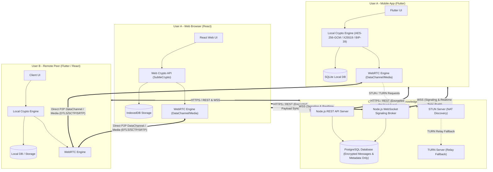
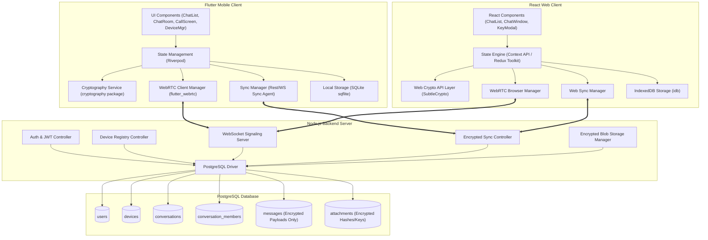
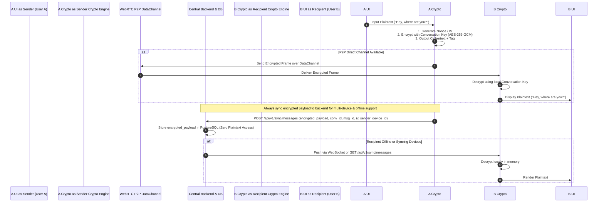
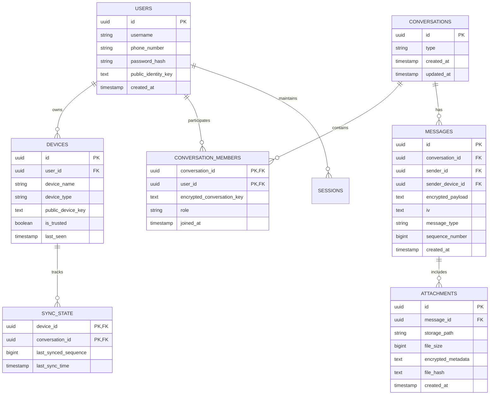
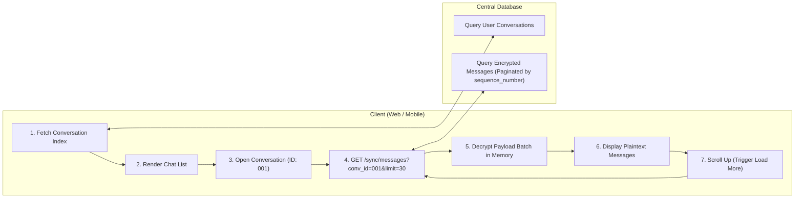

# P2P Messenger: Peer-to-Peer Messaging with Encrypted Central Synchronization
## Complete System Architecture & Specification

**Project Title:** P2P Messenger  
**Domain:** Computer Networks, Distributed Systems, End-to-End Cryptography  
**Stack:** Flutter + Dart (Mobile), React.js (Web), Node.js + Express + WebSockets (Backend), PostgreSQL (Database), SQLite (Mobile Local Storage)  
**Security Standard:** Zero-Knowledge Backend Architecture, Multi-Device End-to-End Encryption (AES-256-GCM, X25519, Ed25519, HKDF)  
**Version:** 2.1.0 (Post-Review Corrected & Enhanced Architecture)  

---

## 1. System Architecture

The P2P Messenger is a hybrid decentralized communication system combining direct Peer-to-Peer (P2P) WebRTC communication for real-time low-latency interaction with a Zero-Knowledge Encrypted Synchronization Central Backend.

### 1.1 Architectural Principles
1. **Zero-Knowledge Backend:** The Node.js server and PostgreSQL database store *only encrypted payloads*, ciphertext blobs, session tokens, and routing metadata. No central server owner, operator, or database administrator can read plaintext messages, view attachments, or access private keys.
2. **P2P Priority Transport:** When peers are online and reachable, real-time messages, audio, video, and file streams travel directly over WebRTC DataChannels (SCTP over DTLS/UDP) and WebRTC MediaStreams (SRTP over UDP).
3. **Encrypted Central Backup & Sync:** All conversation messages and file metadata are encrypted locally on the sending client before being sent to the central PostgreSQL database. This allows offline messaging, multi-device synchronization, and full conversation history retrieval without compromising privacy.
4. **Multi-Device Authorization:** Every authorized device (Mobile App, Web Browser, Desktop) maintains its own cryptographic key pair ($IK_d$). Device enrollment uses QR-code pairing and out-of-band key verification.

### 1.2 Top-Level System Topology Diagram



---

## 2. Network Architecture & Protocol Stack

The system decouples **Control Plane / Sync Plane** from **Direct Data Plane**.

```
+---------------------------------------------------------------------------------------+
|                                    APPLICATION LAYER                                  |
|   Flutter Mobile UI | React Web UI | E2EE (AES-256-GCM / X25519) | File Chunking    |
+---------------------------------------------------------------------------------------+
|                 CONTROL & SYNC PLANE                |            DATA PLANE           |
|            (Server-Assisted Zero-Knowledge)         |     (Direct Peer-to-Peer)      |
+-----------------------------------------------------+---------------------------------+
|  REST APIs (HTTPS) | Signaling & Push (WSS JSON)    | WebRTC DataChannel (SCTP/DTLS)  |
|  Encrypted Sync & Auth Tokens                       | WebRTC Media Stream (SRTP)      |
+-----------------------------------------------------+---------------------------------+
|               TLS 1.3 / TCP (Port 443)              |      DTLS 1.2/1.3 over UDP      |
+-----------------------------------------------------+---------------------------------+
|                                 INTERNET PROTOCOL (IP)                                |
|                        IPv4 / IPv6 + NAT Traversal (STUN / TURN)                      |
+-----------------------------------------------------+---------------------------------+
```

---

## 3. Component Diagram



---

## 4. Data Flow Diagram

### 4.1 Message Lifecycle & Encryption Data Flow



---

## 5. P2P Communication Flow

```mermaid
sequenceDiagram
    autonumber
    participant PeerA as Peer A (Initiator)
    participant SigServer as Signaling Server (Node.js WS)
    participant PeerB as Peer B (Receiver)
    participant STUN as STUN / TURN Server

    PeerA->>SigServer: WS Connect & Authenticate (JWT)
    PeerB->>SigServer: WS Connect & Authenticate (JWT)
    
    PeerA->>STUN: Request STUN Candidates
    STUN-->>PeerA: Return Public reflexive IP:Port
    
    PeerA->>SigServer: Send SDP Offer { target: PeerB, sdp: "..." }
    SigServer->>PeerB: Forward SDP Offer { sender: PeerA, sdp: "..." }
    
    PeerB->>STUN: Request STUN Candidates
    STUN-->>PeerB: Return Public reflexive IP:Port
    
    PeerB->>SigServer: Send SDP Answer { target: PeerA, sdp: "..." }
    SigServer->>PeerA: Forward SDP Answer { sender: PeerB, sdp: "..." }
    
    PeerA->>SigServer: Send Trickle ICE Candidate
    SigServer->>PeerB: Forward ICE Candidate
    PeerB->>SigServer: Send Trickle ICE Candidate
    SigServer->>PeerA: Forward ICE Candidate
    
    note over PeerA, PeerB: Direct DTLS/ICE Handshake succeeds
    PeerA<==>PeerB: Established Direct WebRTC DataChannel / MediaStream
```

---

## 6. Database Architecture

The PostgreSQL database stores structural metadata and encrypted ciphertext blobs.

### Key Rules Enforced:
1. `messages.encrypted_payload`: BYTEA / TEXT containing AES-256-GCM ciphertext + auth tag.
2. `messages.iv`: Initialization Vector for the GCM cipher.
3. No plaintext column exists for message content, filenames, or media URLs.
4. `attachments.encrypted_metadata`: Contains encrypted original file name, mime type, and file encryption key wrapped under the conversation key.



---

## 7. Encryption / Decryption Flow & Recovery Architecture

### 7.1 Key Hierarchy
1. **User Identity Key Pair ($IK_u$):** Ed25519 (signing) and X25519 (key agreement) generated at account creation.
2. **Device Key Pair ($IK_d$):** Generated per device (mobile, web browser). Private key ($SK_d$) stored securely in system storage (`flutter_secure_storage` on mobile, encrypted IndexedDB / SubtleCrypto non-extractable on web).
3. **Conversation Symmetric Key ($K_{conv}$):** AES-256 key unique to each conversation. Shared among authorized members and authorized user devices.
4. **Key Envelope:** $K_{conv}$ is wrapped for each authorized device using ECIES / HKDF + AES-KW with the device's public key ($PK_d$).

### 7.2 Zero-Knowledge Password Recovery & Key Escrow (BIP-39 Mnemonic)
- **Problem:** If a user loses their password or logs in from a brand-new device without QR scanning, how do they recover keys without giving the server access?
- **Solution:** At initial user registration, a 12-word BIP-39 mnemonic recovery phrase is generated on the client device.
  - The master seed derives a **Root Private Key**.
  - Server password reset updates authentication credentials (`password_hash`) on PostgreSQL, but **NEVER touches private keys or message history**.
  - If a user loses all authorized devices, entering their 12-word recovery phrase locally re-derives their Root Identity Key and allows decrypting their personal key backup envelope without server intervention.

---

## 8. Web Application Architecture

The web application is built using **React.js** with TypeScript and Vite. It serves as an authorized desktop client capable of local key management and client-side decryption.

### 8.1 Key Layers & Features
- **Authentication & Authorization:** JWT access token stored in memory / HTTP-only secure cookie; non-extractable CryptoKey objects in browser `SubtleCrypto`.
- **Web Crypto Engine:** Uses native browser `window.crypto.subtle` for zero-dependency high-performance AES-GCM decryption and X25519 key derivation.
- **Incremental Loading & Lazy Decryption:**
  - Fetches conversation index via `/api/v1/conversations`.
  - When user opens a conversation, fetches paginated encrypted message pages (e.g. 50 messages per page).
  - Decrypts messages asynchronously in memory web workers so UI never freezes.
- **IndexedDB Caching:** Decrypted or encrypted messages cached in IndexedDB for offline web access.

---

## 9. Mobile Application Architecture

The mobile application is built using **Flutter + Dart**, following **Clean Architecture** with **Riverpod** state management.

### 9.1 Module Layout
- **Presentation Layer:** Flutter Widgets, Material 3 Dark UI, Chat Screens, QR Pairing Views.
- **Domain Layer:** Entities, Use Cases (SendMessageUseCase, DecryptHistoryUseCase, SyncConversationsUseCase).
- **Data Layer:** 
  - `DatabaseService`: SQLite via `sqflite` for local chat storage.
  - `CryptoService`: `cryptography` package for AES-256-GCM, X25519.
  - `WebRTCService`: `flutter_webrtc` for P2P connection handling.
  - `SyncRepository`: HTTP/WebSocket sync client.

---

## 10. Multi-Device Architecture & Revocation Dynamics

### 10.1 Device Authorization (QR Pairing)
1. Web browser generates $PK_{web}$.
2. Authorized Mobile app scans QR code containing pairing challenge and $PK_{web}$.
3. Mobile app encrypts $K_{conv}$ using $PK_{web}$ and uploads the envelope to `POST /api/v1/devices/pair`.
4. Browser downloads key envelope, decrypts $K_{conv}$ locally using $SK_{web}$, and gains full history decryption capability.

### 10.2 Device Revocation & Conversation Key Rotation
- When a user revokes a device (e.g., lost laptop):
  1. Server invalidates the revoked device's session token and marks `is_trusted = false` in `devices`.
  2. Remaining authorized clients trigger a **Conversation Key Rotation** ($K_{conv} \rightarrow K'_{conv}$).
  3. Future messages in the conversation are encrypted using $K'_{conv}$.
  4. $K'_{conv}$ is wrapped *only* for active, trusted device keys ($PK_{active}$).
  5. The revoked device cannot decrypt future messages even if it captures encrypted payloads from the network.

---

## 11. Chat History Architecture



---

## 12. Authentication Architecture

1. **Authentication vs Encryption Separation:**
   - **Authentication:** Verifies user identity to the server using standard Argon2id password hashing + JWT access/refresh tokens.
   - **Encryption:** Secures content. The server handles auth tokens but never receives private keys or master decryption secrets.
2. **Session Security:**
   - Access Tokens (JWT, 15-min lifespan).
   - Refresh Tokens (Stored in HTTP-only Secure Cookies / Secure Storage, 7-day lifespan).
   - Device Binding: JWT tokens are bound to `device_id`.

---

## 13. Signaling Architecture

The Node.js WebSocket signaling broker handles ephemeral WebRTC signaling.

### Message Isolation:
- Signaling messages contain only SDP offers, SDP answers, and ICE candidates.
- Ephemeral in-memory routing: zero disk writes or database logging of signaling frames.

---

## 14. NAT / STUN / TURN Architecture

- **STUN (Port 3478):** Used for reflexive candidate gathering.
- **TURN (Port 3478 / TURNS 5349):** Configured as a fallback for double symmetric NAT environments.

---

## 15. File-Transfer Architecture & Resumption Protocol

### 15.1 Chunked Transfer & Resumption Protocol
- **Chunk Size:** 16 KB per DataChannel chunk.
- **Resumption Mechanism:**
  - Sender includes a unique `file_transfer_id` and SHA-256 chunk checksums.
  - Receiver tracks received chunk indices in a bitmask.
  - If a connection drops during a 100 MB file transfer, upon reconnection receiver sends a ACK range query (`{ "resuming": true, "missing_chunks": [140, 141, 142, ...] }`).
  - Sender re-transmits only missing chunks.
- **Encrypted Media Storage Fallback:**
  - If offline, file is encrypted locally with a unique $K_{file}$ (AES-256-GCM) and uploaded to `/api/v1/attachments/upload` using HTTP Range headers for resumable uploads.

---

## 16. Synchronization Architecture

- Every message in a conversation receives a monotonically increasing `sequence_number`.
- Clients track `last_synced_sequence` locally. On connection, clients request missing deltas starting from `last_synced_sequence + 1`.

---

## 17. Security Threat Model & Audit Matrix

| Threat Vector | Potential Impact | Mitigation Architecture | Verified in Review |
| :--- | :--- | :--- | :--- |
| **Backend / DB Compromise** | Attacker dumps PostgreSQL DB | Payloads encrypted with client AES-256-GCM. Zero plaintext stored. | YES |
| **Malicious Signaling Server** | Attacker intercepts WS signals | Payload E2EE operates independently of WebRTC transport. | YES |
| **Stolen Password** | Login from unknown device | Password grants auth, NOT keys. Device needs QR pairing or BIP-39 phrase. | YES |
| **Device Revocation** | Lost device captures traffic | Key rotation ($K_{conv} \rightarrow K'_{conv}$) isolates future messages. | YES |
| **Replay Attacks** | Re-sent encrypted frames | Sequence numbers, timestamps, and GCM IV uniqueness check reject duplicates. | YES |

---

## 18. Project Folder Structure

```
p2p_messenger/
├── .agents/                    # Workspace agent rules & specs
├── ARCHITECTURE.md             # Complete System Architecture Specification
├── README.md                   # Project overview & running instructions
├── pubspec.yaml                # Flutter dependencies
├── package.json                # Root / workspace configuration
├── lib/                        # Flutter Mobile Application
│   ├── main.dart               # App entrypoint
│   ├── crypto/                 # E2EE Crypto Engine (AES-GCM, Key Management)
│   ├── database/               # Local SQLite database & migrations
│   ├── models/                 # Dart Data Models (User, ChatMessage, Conversation)
│   ├── networking/             # WebRTC P2P Manager & Signaling Client
│   ├── services/               # Sync Service, Auth Service, Device Service
│   └── ui/                     # Flutter UI Screens & Riverpod Providers
├── web_app/                    # React Web Application (Authorized Browser Client)
│   ├── package.json
│   ├── vite.config.ts
│   ├── index.html
│   └── src/
│       ├── main.tsx
│       ├── crypto/             # WebCrypto API Layer (SubtleCrypto)
│       ├── services/           # REST API & WebSocket Sync Client
│       ├── components/         # React Components (ChatList, ChatRoom, Auth)
│       └── store/              # State Management
├── signaling_server/           # Node.js Backend Server
│   ├── package.json
│   ├── server.js               # Entrypoint & Express / WS setup
│   ├── config/                 # Database & Environment config
│   ├── controllers/            # Auth, Sync, Device, and Signaling Controllers
│   ├── middleware/             # JWT Authentication & Rate Limiting
│   ├── models/                 # PostgreSQL Pool & Queries
│   └── test/                   # Integration and Unit Tests
└── test/                       # Flutter Unit & Integration Tests
```

---

## 19. REST & WebSocket API Structure

### 19.1 REST Endpoints
- `POST /api/v1/auth/register` - User registration
- `POST /api/v1/auth/login` - User login & JWT issuance
- `POST /api/v1/devices/register` - Register new device public key
- `GET /api/v1/devices/` - List user authorized devices
- `POST /api/v1/devices/pair` - Upload encrypted conversation key envelope for new paired device
- `GET /api/v1/conversations` - Get conversation index & latest encrypted message preview
- `POST /api/v1/conversations` - Create new 1-to-1 conversation
- `GET /api/v1/conversations/:id/messages` - Fetch paginated encrypted messages
- `POST /api/v1/sync/messages` - Post new encrypted message payload
- `POST /api/v1/attachments/upload` - Upload encrypted media payload
- `GET /api/v1/attachments/:id` - Download encrypted media payload

### 19.2 WebSocket Events
- `connect` - Establish signaling & push session with JWT query token
- `signal_offer` / `signal_answer` / `signal_ice` - WebRTC P2P negotiation broker
- `push_message` - Real-time notification of new encrypted message arrival

---

## 20. Database Schema (PostgreSQL DDL)

```sql
CREATE EXTENSION IF NOT EXISTS "uuid-ossp";

-- Users Table
CREATE TABLE users (
    id UUID PRIMARY KEY DEFAULT uuid_generate_v4(),
    username VARCHAR(50) UNIQUE NOT NULL,
    phone_number VARCHAR(20) UNIQUE NOT NULL,
    password_hash VARCHAR(255) NOT NULL,
    public_identity_key TEXT NOT NULL,
    created_at TIMESTAMP WITH TIME ZONE DEFAULT CURRENT_TIMESTAMP
);

-- Devices Table
CREATE TABLE devices (
    id UUID PRIMARY KEY DEFAULT uuid_generate_v4(),
    user_id UUID NOT NULL REFERENCES users(id) ON DELETE CASCADE,
    device_name VARCHAR(100) NOT NULL,
    device_type VARCHAR(20) NOT NULL, -- 'mobile', 'web', 'desktop'
    public_device_key TEXT NOT NULL,
    is_trusted BOOLEAN DEFAULT FALSE,
    last_seen TIMESTAMP WITH TIME ZONE DEFAULT CURRENT_TIMESTAMP,
    created_at TIMESTAMP WITH TIME ZONE DEFAULT CURRENT_TIMESTAMP
);

-- Conversations Table
CREATE TABLE conversations (
    id UUID PRIMARY KEY DEFAULT uuid_generate_v4(),
    type VARCHAR(20) DEFAULT 'direct', -- 'direct', 'group'
    created_at TIMESTAMP WITH TIME ZONE DEFAULT CURRENT_TIMESTAMP,
    updated_at TIMESTAMP WITH TIME ZONE DEFAULT CURRENT_TIMESTAMP
);

-- Conversation Members Table
CREATE TABLE conversation_members (
    conversation_id UUID NOT NULL REFERENCES conversations(id) ON DELETE CASCADE,
    user_id UUID NOT NULL REFERENCES users(id) ON DELETE CASCADE,
    encrypted_conversation_key TEXT NOT NULL, -- Key envelope wrapped per user/device key
    role VARCHAR(20) DEFAULT 'member',
    joined_at TIMESTAMP WITH TIME ZONE DEFAULT CURRENT_TIMESTAMP,
    PRIMARY KEY (conversation_id, user_id)
);

-- Encrypted Messages Table (ZERO PLAINTEXT STORED)
CREATE TABLE messages (
    id UUID PRIMARY KEY DEFAULT uuid_generate_v4(),
    conversation_id UUID NOT NULL REFERENCES conversations(id) ON DELETE CASCADE,
    sender_id UUID NOT NULL REFERENCES users(id) ON DELETE CASCADE,
    sender_device_id UUID NOT NULL REFERENCES devices(id),
    encrypted_payload TEXT NOT NULL, -- Base64 AES-256-GCM Ciphertext + Auth Tag
    iv TEXT NOT NULL,               -- Base64 Initialization Vector
    message_type VARCHAR(20) DEFAULT 'text', -- 'text', 'image', 'video', 'document', 'audio'
    sequence_number BIGSERIAL NOT NULL,
    created_at TIMESTAMP WITH TIME ZONE DEFAULT CURRENT_TIMESTAMP
);

-- Encrypted Attachments Table
CREATE TABLE attachments (
    id UUID PRIMARY KEY DEFAULT uuid_generate_v4(),
    message_id UUID NOT NULL REFERENCES messages(id) ON DELETE CASCADE,
    storage_path TEXT NOT NULL,
    file_size BIGINT NOT NULL,
    encrypted_metadata TEXT NOT NULL, -- Encrypted file name, mime-type, and file key
    file_hash VARCHAR(64) NOT NULL,    -- SHA-256 hash of encrypted binary
    created_at TIMESTAMP WITH TIME ZONE DEFAULT CURRENT_TIMESTAMP
);

-- Sync State per Device
CREATE TABLE sync_state (
    device_id UUID NOT NULL REFERENCES devices(id) ON DELETE CASCADE,
    conversation_id UUID NOT NULL REFERENCES conversations(id) ON DELETE CASCADE,
    last_synced_sequence BIGINT DEFAULT 0,
    last_sync_time TIMESTAMP WITH TIME ZONE DEFAULT CURRENT_TIMESTAMP,
    PRIMARY KEY (device_id, conversation_id)
);

-- User Sessions Table
CREATE TABLE sessions (
    id UUID PRIMARY KEY DEFAULT uuid_generate_v4(),
    user_id UUID NOT NULL REFERENCES users(id) ON DELETE CASCADE,
    device_id UUID NOT NULL REFERENCES devices(id) ON DELETE CASCADE,
    token_hash VARCHAR(255) NOT NULL,
    expires_at TIMESTAMP WITH TIME ZONE NOT NULL,
    created_at TIMESTAMP WITH TIME ZONE DEFAULT CURRENT_TIMESTAMP
);

-- Indexes for Fast Querying & Incremental Sync
CREATE INDEX idx_messages_conv_seq ON messages(conversation_id, sequence_number ASC);
CREATE INDEX idx_devices_user ON devices(user_id);
CREATE INDEX idx_members_user ON conversation_members(user_id);
```

---

## 21. Development Phases

```
PHASE 1  → Flutter UI (COMPLETED: Mobile shell, Navigation, Auth UI, Unlimited Chat List UI)
PHASE 2  → SQLite (Local database storage using sqflite & sqflite_common_ffi)
PHASE 3  → Identity + Key Architecture (Ed25519 & X25519 client key generation & local vault)
PHASE 4  → Local/LAN Networking (Local peer discovery & direct socket communication)
PHASE 5  → WebRTC DataChannel (Direct SCTP over DTLS/UDP messaging on mobile)
PHASE 6  → Signaling (Node.js WebSocket signaling server & session broker)
PHASE 7  → Internet P2P (Out-of-band signaling exchange & direct P2P connectivity over Internet)
PHASE 8  → STUN/ICE/TURN (NAT Traversal discovery & TURN relay fallback implementation)
PHASE 9  → E2E Encrypted Messages (Application-layer AES-256-GCM message encryption/decryption)
PHASE 10 → Encrypted Synchronization (Posting & pulling encrypted message deltas to/from backend)
PHASE 11 → Node.js + PostgreSQL (Backend REST APIs, Zero-Knowledge DB schema, and authentication)
PHASE 12 → Encrypted Media/Files (Chunked file transfer, SHA-256 hashes, and encrypted storage fallback)
PHASE 13 → React Website (Web application SPA interface, search, and chat room UI)
PHASE 14 → Browser-side Decryption (Web Crypto API SubtleCrypto local key handling & IndexedDB cache)
PHASE 15 → Browser ↔ P2P (Cross-platform WebRTC DataChannel connection between Browser and Mobile)
PHASE 16 → Voice/Video Calls (WebRTC MediaStreams audio/video calling & call controls)
PHASE 17 → Offline Synchronization (Offline message queue, reconnect auto-sync, and sequence tracking)
PHASE 18 → Multi-Device (QR pairing protocol, multi-device session binding, and key envelope distribution)
PHASE 19 → Recovery (Zero-knowledge BIP-39 mnemonic phrase key backup & device revocation rotation)
PHASE 20 → Security Testing (Database Zero-Knowledge audits, key leakage analysis, & MITM simulations)
PHASE 21 → Network/Performance Testing (WebRTC NAT stress testing, bandwidth, & latency benchmarks)
PHASE 22 → Production Deployment (Nginx reverse proxy, production Node.js runner, & domain setup)
```

---

## 22. Testing Strategy

1. **Unit Testing:**
   - Cryptographic round-trip tests (encrypting with client key, verifying ciphertext, decrypting back to plaintext).
   - Key derivation unit tests (HKDF outputs match across Dart, JS, and Node).
   - Data structure serialization/deserialization tests.
2. **Integration Testing:**
   - Database tests: Assert that inserting a message with plaintext fails schema/security constraints and that stored content in `messages.encrypted_payload` is unreadable without client keys.
   - REST API tests: Authentication, JWT expiration, device registration endpoints using `supertest`.
3. **P2P & WebRTC Network Simulation:**
   - Automated WebRTC connection tests across mock peer interfaces.
   - NAT traversal testing with public STUN servers and TURN relay simulation.
4. **End-to-End (E2E) Flow Testing:**
   - Multi-device pairing simulation: Mobile app creates account -> Web browser pairs via QR -> Web browser fetches encrypted sync messages -> Web browser decrypts and displays identical chat list.

---

## 23. Deployment Architecture

Standard native Node.js application + native PostgreSQL service (Zero Docker / Zero Firebase dependency). Nginx acts as reverse proxy and static asset server for the React web app.

---

## 24. Domain Integration Architecture

Custom domain (e.g. `https://example.com`) routes static React build, HTTPS REST APIs (`/api/v1`), and WSS signaling (`/ws`).
